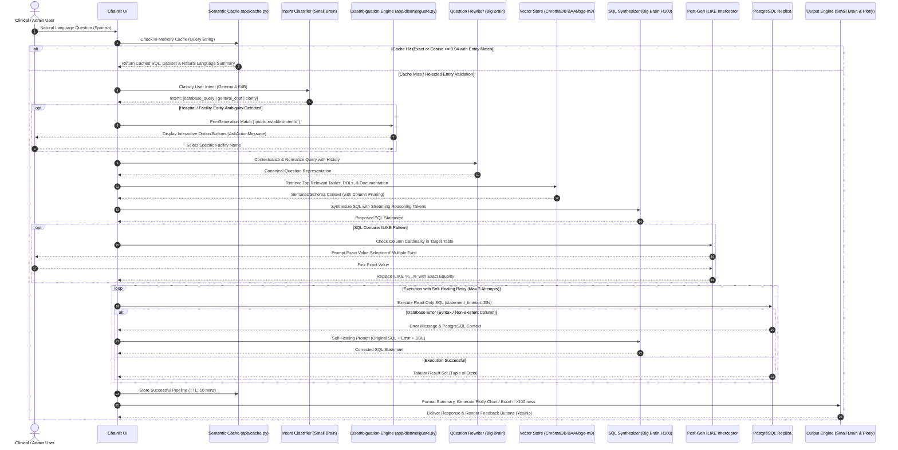

# Architectural Specification: Enterprise Healthcare Text-to-SQL Engine

This document outlines the detailed system architecture, engineering patterns, data flows, and algorithmic mechanisms implemented across the Healthcare Information System (HIS) Text-to-SQL platform.

---

## 1. End-to-End Query Execution Pipeline



---

## 2. Dual-Brain Inference Engine

To achieve sub-second conversational latency while maintaining state-of-the-art SQL generation accuracy, the system decouples cognitive workloads across two specialized open-weights models served via high-throughput **vLLM** engines:

```
┌────────────────────────────────────────────────────────────────────────┐
│                        DUAL-BRAIN TOPOLOGY                             │
├───────────────────────────────────┬────────────────────────────────────┤
│ Big Brain (Reasoning & SQL)       │ Small Brain (Orchestration & UI)   │
├───────────────────────────────────┼────────────────────────────────────┤
│ • Model: Gemma 4 31B FP8          │ • Model: Gemma 4 E4B GPTQ INT4     │
│ • Hardware: NVIDIA H100 (80GB)    │ • Hardware: NVIDIA RTX A4500 (20GB)│
│ • Context Window: 32,768 tokens   │ • Context Window: 32,768 tokens    │
│ • Temperature: 0.1 (Deterministic)│ • Temperature: 1.0 / 0.7           │
│ • Responsibilities:               │ • Responsibilities:                │
│   - Question contextual rewriting │   - Intent classification (Fast)   │
│   - Relational schema reasoning   │   - Small-talk & general dialogue  │
│   - Multi-join SQL synthesis      │   - Natural language formatting    │
│   - Autonomous error self-healing │   - Chart recommendation logic     │
└───────────────────────────────────┴────────────────────────────────────┘
```

---

## 3. High-Precision Semantic Cache Architecture

Repeated or trivially rephrased questions bypass the full inference pipeline using an in-memory vector cache (`app/cache.py`):

1. **Exact Fast Path**:
   - The query string is normalized (lowercased, stripped of punctuation, accents, and excessive whitespace) and looked up in a thread-safe dictionary with a **10-minute TTL**.
2. **Semantic Vector Path**:
   - Computes dense vector embeddings using `BAAI/bge-m3`.
   - Computes cosine similarity against all active cached entries. A candidate match must exceed a strict **0.94 similarity threshold**.
3. **Deterministic Entity Guardrails**:
   - Even when cosine similarity is above 0.94, the system prevents dangerous ID or proper-noun cross-contamination.
   - A deterministic regex extractor pulls all numbers (`\b\d+\b`) and capitalized proper nouns from both queries.
   - If the extracted entities differ (e.g., *Query A* queries patient ID `1024` and *Query B* queries `2048`), the cache match is **strictly rejected**, triggering a fresh generation cycle.
4. **Failure Quarantine**:
   - Only pipelines resulting in successful SQL executions and non-empty result sets are ever written to cache.

---

## 4. Modern Data Stack: dbt Semantic Layer

The operational database contains **114 normalized transactional tables**. Directly exposing this raw schema to an LLM introduces severe failure modes: schema hallucination, non-deterministic join paths, and Cartesian-product query timeouts.

### 4.1. Three-Tier Transformation Pipeline
- **Staging (`stg_*`)**: One-to-one clean representations of source tables. Removes legacy non-standard flags, casts custom timestamps (combining split `creacion_fecha` + `creacion_hora`), and sanitizes column names.
- **Intermediate (`int_*`)**: Houses business logic, identity mapping, and historical rollups.
- **Marts (`mart_*`)**: Purpose-built dimensional and aggregated tables residing in the `dbt_analytics` schema. All foreign geographic keys (districts, departments, regions) are pre-joined into human-readable text columns, enforcing a strict zero-join rule for the LLM.

### 4.2. Lambda Architecture for Ultra-Low Latency Analytics
For high-frequency aggregations (e.g., `mart_totales_consultas_por_tipo` covering millions of patient visits):
- **Batch Layer (`int_*_historico`)**: An incremental dbt model that pre-computes daily metrics up to `CURRENT_DATE - 1`. It runs via an automated background daemon (`run_scheduler.py`) at 01:00 AM.
- **Speed Layer (`int_*_hoy`)**: A dynamic SQL view that computes only today's live transactions:
  ```sql
  WHERE fecha_consulta >= CURRENT_DATE
  ```
- **Serving View**: Unites both layers using an indexed `UNION ALL`:
  ```sql
  SELECT * FROM {{ ref('int_totales_consultas_historico') }}
  UNION ALL
  SELECT * FROM {{ ref('int_totales_consultas_hoy') }}
  ```
This architecture reduces query execution time from **45+ seconds to under 180 milliseconds**.

### 4.3. Business Rule Logic: Decentralized Role Attribution
In this healthcare system, traditional role/permission tables are decentralized. Staff roles are computed deterministically by joining the `creacion_usuario` audit field across specific transaction tables:
- **Physicians**: `consulta.creacion_usuario`
- **Triage Nurses**: `preconsulta.creacion_usuario`
- **Admission Clerks**: `paciente_asignacion.creacion_usuario`
- **Pharmacists**: `consulta_medicamento.creacion_usuario`

To ensure unique counts across autonomous regional clinics where primary keys may collide locally, the semantic models enforce a **composite global key**:
```sql
codigo_establecimiento || '-' || codigo_asignacion
```

---

## 5. Dynamic Vector RAG & Schema Pruning

ChromaDB acts as the real-time catalog memory:
1. **Startup Synchronization (`seed_dbt.py`)**: Automatically parses dbt's compiled `manifest.json` and `catalog.json`, generating rich synthetic DDL statements containing table and column descriptions.
2. **Column Pruning Regex Filter**: Transactional tables often have pure internal audit columns (`modificacion_fecha`, `modificacion_hora`, `modificacion_usuario`, `btimestamp`). Before DDLs are fed into the prompt, a regex pipeline strips these attributes, decreasing the prompt token footprint by **~38%** and drastically reducing Time-To-First-Token (TTFT).

---

## 6. Autonomous Self-Healing Reflection Engine

If a generated SQL statement fails execution due to a PostgreSQL error (e.g., column mismatch or invalid type conversion):
1. The exception message and SQL state are captured.
2. The pipeline transitions into an autonomous reflection loop.
3. A focused prompt containing:
   - The user's original query.
   - The failed SQL statement.
   - The exact PostgreSQL error message.
   - The relevant table DDL definitions.
4. The Big Brain identifies the syntax or semantic defect, formulates an explanation, and outputs an alternative executable query.

---

## 7. Security, Auditing & Access Controls

- **Database Hardening**:
  - The application connects via a dedicated `readonly_ai` PostgreSQL user.
  - Hard timeouts (`SET statement_timeout = '30000'`) prevent denial-of-service via runaway queries.
  - `isdc = 'N'` and `is_outdated = false` filters are injected into system prompts to enforce audit record validity.
- **Privacy (Zero-PII)**:
  - System prompts strictly mandate masking or omitting individual patient names, addresses, identification numbers, and contact information.
- **Application Authentication & Feedback**:
  - User accounts are stored in a segregated PostgreSQL database (`chainlit-db`) with bcrypt salted password hashing.
  - Every generated answer contains interactive feedback triggers that log accuracy ratings into a dedicated `sql_feedback` table for continuous model evaluation.
