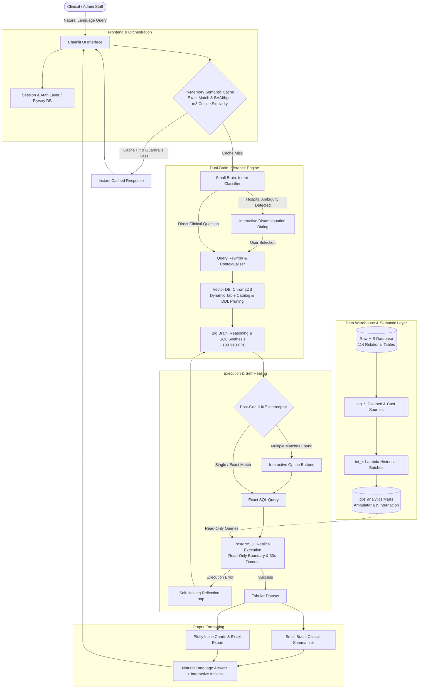

# Hospital Information System (HIS) — Enterprise Text-to-SQL & Analytics Platform

[](https://www.python.org/)
[](https://chainlit.io/)
[](https://vllm.ai/)
[](https://www.getdbt.com/)
[](https://www.trychroma.com/)
[](https://www.postgresql.org/)
[](https://www.docker.com/)

An enterprise-grade, privacy-first **Text-to-SQL conversational intelligence platform** designed for a **nationwide public hospital network**. The system enables clinical and administrative staff to query real-time hospital operational databases in natural Spanish—translating questions into high-performance, strictly read-only SQL queries executed across millions of clinical records.

---

## Key Engineering Highlights

- **Dual-Brain LLM Topology**: Decoupled reasoning across specialized self-hosted models:
  - **Big Brain (Gemma 4 31B FP8 on NVIDIA H100)**: Deep clinical reasoning, intent disambiguation, and complex SQL generation.
  - **Small Brain (Gemma 4 E4B GPTQ on NVIDIA RTX A4500)**: Fast intent classification, UI stream orchestration, and natural language formatting.
- **dbt Semantic Layer & Lambda Architecture**: Distills **114 raw transactional tables** into clean analytical data marts (`dbt_analytics`). Eliminates query timeouts by unifying historical batch aggregates (incremental materialization) with zero-latency operational views (`UNION ALL`).
- **Semantic Caching with Entity Guardrails**: Sub-millisecond response for recurring queries via hybrid caching: exact hash check + cosine similarity (`BAAI/bge-m3` embeddings, threshold 0.94) coupled with deterministic regex entity verification (rejecting matches with differing patient IDs or proper nouns).
- **Interactive Disambiguation Engine**:
  - *Pre-generation*: Automatically resolves ambiguous hospital or facility names via interactive UI button dialogs.
  - *Post-generation*: Dynamically intercepts generated `ILIKE` clauses against database columns, querying distinct values and prompting users before execution.
- **Autonomous Self-Healing SQL**: Intercepts PostgreSQL syntax or schema errors and routes them into a reflection retry loop where the LLM diagnoses the schema violation and synthesizes a corrected query.
- **Inline Analytics & Visualizations**: Automatically detects query result shapes to render interactive **Plotly charts** inline (bar, line, pie) and generates streaming **Excel (.xlsx)** exports for datasets exceeding 100 records.

---

## System Architecture



---

## Modern Data Stack (dbt Semantic Layer)

To shield the language model from the complexity and potential deadlocks of 114 transactional operational tables, a dedicated dbt data warehouse layer materializes clean, dimensional views in the `dbt_analytics` schema:

| Domain | Key Data Marts | Business Purpose |
|---|---|---|
| **Ambulatory Care** | `mart_consultas` | Normalized timeline of outpatient appointments, triage, and doctor evaluations. |
| **Diagnostics** | `mart_diagnosticos_ambulatorios` | ICD-10 (CIE-10) diagnosis registry enriched with patient residence and hospital regions. |
| **Capacity & Beds** | `mart_camas_disponibilidad_resumen` | Real-time bed status (occupied, available, maintenance) aggregated by facility and ward. |
| **Hospitalization** | `mart_altas_egresos`, `mart_cirugias` | Inpatient stays, SOAP clinical evolutions, surgical procedures, and discharge summaries. |
| **Prescriptions** | `mart_medicamentos_recetados` | Outpatient and inpatient pharmaceutical dispensations and administration routes. |
| **Demographics** | `mart_pacientes_detalle` | Unified patient identity, chronic condition profiling, and geographical distribution. |

### The Lambda Architecture Pattern
High-volume analytical queries (such as cumulative consultation totals or top historical diagnoses) utilize a **Lambda Architecture** inside dbt:
1. **Batch Layer (`int_*_historico`)**: An `incremental` dbt model precalculating historical metrics up to yesterday.
2. **Speed Layer (`int_*_hoy`)**: A lightweight real-time `view` computing today's live incoming metrics.
3. **Serving Mart**: A final view applying `UNION ALL` across both layers, eliminating multi-table sequential scans and keeping query latency below 200ms.

---

## Security, Privacy & Compliance

- **Strict Read-Only Enforcement**: The application operates against dedicated read-only database credentials with PostgreSQL session timeouts (`statement_timeout=30s`).
- **Zero-PII Prompts**: Mandatory prompt-level constraints prohibit selecting identifiable patient data (full names, national identity numbers, home addresses, phone numbers).
- **Air-Gapped / On-Premises Capability**: Self-hosted vLLM containers and local ChromaDB embeddings ensure zero patient data leaves internal hospital network boundaries.

---

## Quickstart & Local Deployment

### 1. Prerequisites
- [Docker](https://docs.docker.com/get-docker/) & [Docker Compose](https://docs.docker.com/compose/)
- Access to a PostgreSQL database (or local test instance)
- Access to OpenAI-compatible LLM endpoints (e.g. self-hosted vLLM or cloud API)

### 2. Environment Setup
Clone the repository and prepare the configuration:
```bash
git clone https://github.com/your-username/his-text2sql-platform.git
cd his-text2sql-platform

cp .env.example .env
# Edit .env with your PostgreSQL credentials and LLM endpoints
```

### 3. Launch Services
Run the full container stack (Application UI, Flyway Migrations, dbt Runner, and Chainlit State DB):
```bash
docker compose up --build -d
```

### 4. Create an Administrator / User
Execute the bundled bcrypt credential generator:
```bash
python create_user.py admin SuperSecretPassword123 "Dr. Admin" admin
```
Insert the generated SQL statement into the `chainlit-db` PostgreSQL instance.

### 5. Access the Interface
- **Chat Interface**: Open your browser at `http://localhost:80`
- **Interactive Admin Dashboard**: Navigate to `http://localhost:80/public/admin.html`
- **dbt Documentation**: View interactive DAG lineage and model catalogs at `http://localhost:8080`

---

## Repository Structure

```
├── app/
│   ├── chainlit_app.py        # Main conversational application entrypoint
│   ├── engine.py              # Text2SQLEngine: ChromaDB vector store & RAG retrieval
│   ├── cache.py               # Semantic in-memory cache (bge-m3 + entity guardrails)
│   ├── disambiguate.py        # Interactive hospital & ILIKE pre/post disambiguation
│   ├── llm.py                 # OpenAI-compatible dual-brain client wrappers
│   ├── nodes.py               # Orchestration pipeline nodes (intent, rewrite, execute)
│   ├── prompts.py             # Domain-specific system prompts & PII guardrails
│   ├── reasoning.py           # vLLM reasoning token stream extractor
│   ├── seed_dbt.py            # Startup catalog parser & vector indexer
│   └── public/                # Custom UI themes, avatars, polyfills, and admin dashboard
├── dbt_project/
│   ├── dbt_project.yml        # dbt project configuration & role grants
│   ├── profiles.yml           # Environment-variable driven PostgreSQL connection
│   ├── models/
│   │   ├── staging/           # 1:1 clean views over raw hospital tables
│   │   ├── intermediate/      # Lambda architecture historical batch models
│   │   └── marts/             # High-performance analytical marts (ambulatory & inpatient)
│   └── scripts/
│       └── run_scheduler.py   # Automated batch layer synchronization & docs server
├── flyway/                    # Database migration scripts for user auth and feedback
├── infra/                     # Multi-GPU vLLM deployment templates (H100 & RTX A4500)
├── shell/                     # Migration & maintenance automation scripts
├── docker-compose.yml         # Container orchestration manifest
└── Dockerfile                 # Multi-stage optimized application container
```

---

## Enterprise Value & Impact

- **70% Reduction in Ad-Hoc Analytics Requests**: Enables non-technical medical directors and department heads to self-serve operational reports instantly.
- **Zero Query Failures on Ambiguity**: Interactive disambiguation prompts users to clarify multi-campus facilities before executing heavy queries.
- **Microsecond Latency on High-Frequency Metrics**: Semantic caching delivers instantaneous answers for standard shift reporting and executive KPIs.

---

## License
This project is available under the [MIT License](LICENSE).
